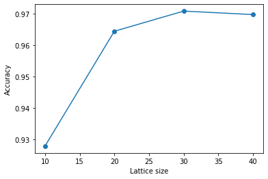
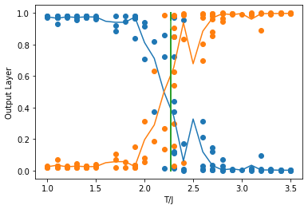
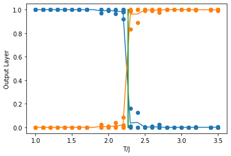
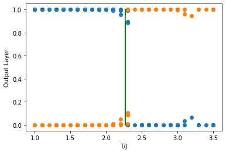

# Machine Learning Models for Identifying Phase Transitions

PHN-300 Lab-Based Project, Department of Physics, IIT Roorkee (Jan–Apr 2023), under Prof. Peayush Kumar Choubey.

This project uses a feed-forward neural network and a convolutional neural network (CNN) to identify the ferromagnetic–paramagnetic phase transition of the 2D Ising model. The networks learn only from raw spin configurations, with no knowledge of the Hamiltonian. It reproduces the feed-forward network results for the 2D Ising ferromagnet from Carrasquilla & Melko, *Machine learning phases of matter*, [Nature Physics 13, 431 (2017)](https://doi.org/10.1038/nphys4035), and extends the comparison to a CNN.

## Dataset

- Spin configurations of the 2D Ising model, H = −J Σ⟨ij⟩ σᵢσⱼ with J = 1 and no external field, sampled by Metropolis Monte Carlo on N × N square lattices.
- Temperatures run from T/J = 1.0 to 3.5 in steps of 0.1.
- There are 26,000 configurations per lattice size, split 85% for training and 15% for testing.
- Each configuration is labelled ferromagnetic (T < T_c) or paramagnetic (T > T_c), where T_c = 2/ln(1+√2) ≈ 2.27.

## Feed-forward neural network

**Architecture:** N² inputs (the flattened lattice) → 100-unit hidden layer → 2 outputs. The two outputs give the probability that the configuration is ferromagnetic or paramagnetic.

**Accuracy vs lattice size.** Test accuracy rises with lattice size: 0.928 (N = 10), 0.964 (N = 20) and 0.971 (N = 30).



**Learned critical temperature.** The figures below plot the output layer against temperature on the test dataset:
- Blue curve: probability that the configuration is ferromagnetic.
- Orange curve: probability that it is paramagnetic.
- Green line: the exact T_c.
- The curves cross at the network's estimate of T_c. That estimate gets closer to the exact value, and the transition gets sharper, as N increases.

| N = 10 | N = 20 | N = 30 |
|---|---|---|
|  |  |  |

The report also notes similar accuracy for antiferromagnetic couplings.

## Convolutional neural network

**Architecture:** 3×3 convolution (ReLU) → fully connected layer (128 neurons, with dropout) → softmax output over the two phases.

**Result:** the CNN reaches above 99% accuracy, compared with about 97% for the feed-forward network. Convolution preserves the spatial structure of the lattice, which the flattened input of the feed-forward network loses.

## Repository structure

```
├── LBP_ML_Phases_of_Matter.ipynb   # data generation, t-SNE, feed-forward network, CNN
├── LBP REPORT FINAL.pdf            # project report
└── data-and-images/
    ├── data/     # Monte Carlo datasets (.npz)
    └── images/   # result figures
```

## Running

The notebook loads the `.npz` files by filename. Either put them next to the notebook, or change the paths to `data-and-images/data/<file>.npz`. To regenerate the data, uncomment the `data_generation(...)` calls.

The notebook is the original exploratory code from 2023.

Full details are in the [project report](LBP%20REPORT%20FINAL.pdf).
